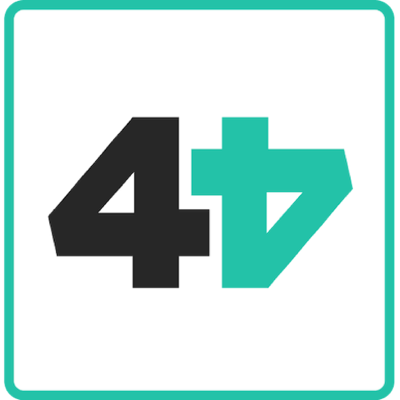

# 4OVER4 connector



Find, configure and price custom printing from 4OVER4.COM in your AI assistant, then order on www.4over4.com. 4OVER4 has printed online since 1999, in its own plant in Queens, NY.

This repository holds no app code. It holds the files that list the 4OVER4 MCP server in assistants and directories: a Claude plugin, a Claude Code marketplace, a Gemini CLI extension and an MCP Registry entry.

**MCP server:** `https://www.4over4.com/appsapi/mcp` (Streamable HTTP, MCP 2025-11-25)
**Sign-in:** OAuth 2.1 with dynamic client registration, at `https://www.4over4.com/appsapi/oauth`
**Help page for AI agents:** https://www.4over4.com/ai-agents
**Developer API description:** https://www.4over4.com/openapi.json

## What you can do

- **Find custom printing:** business cards, flyers, postcards, banners, signs, labels, stickers, invitations and more, by product, industry, occasion or budget.
- **Price it live:** the total and price per piece for your quantity, size, paper, finish and turnaround, plus the quantity price breaks.
- **Delivery dates:** an estimated in-hands date, or live carrier options for your ZIP code.
- **Help:** answers from the 4OVER4 help center on files, bleed, papers, proofs, returns and more.
- **Order:** a priced setup gives a Checkout on 4OVER4 button or a link to www.4over4.com, where you upload artwork, choose shipping and pay. No payment happens in the assistant.
- **After you sign in:** your orders, tracking, invoices, profile, saved addresses, coins and cart; the link to cancel an order yourself on your 4OVER4 orders page.

## Add it to your assistant

### Claude Code

```
/plugin install 4over4 --marketplace 40ver4/4over4-connector
```

On Claude Code before 2.1.275, use two lines:

```
/plugin marketplace add 40ver4/4over4-connector
/plugin install 4over4@fourover4
```

### Claude (web, desktop, mobile)

Settings, Connectors, Add custom connector, then paste `https://www.4over4.com/appsapi/mcp`. Add it on web or desktop first; it then works on mobile too.

### ChatGPT

Search for 4OVER4 in the ChatGPT plugin directory and press Connect. Until the listing is approved, add it in ChatGPT's developer mode as a custom app with the URL `https://www.4over4.com/appsapi/mcp`.

### Gemini CLI

```
gemini extensions install https://github.com/40ver4/4over4-connector
```

### Cursor

Open this link: `cursor://anysphere.cursor-deeplink/mcp/install?name=4over4&config=eyJ1cmwiOiJodHRwczovL3d3dy40b3ZlcjQuY29tL2FwcHNhcGkvbWNwIn0=`

Or add this to `~/.cursor/mcp.json`:

```json
{
  "mcpServers": {
    "4over4": { "url": "https://www.4over4.com/appsapi/mcp" }
  }
}
```

### VS Code

Run "MCP: Add Server", choose HTTP, and paste `https://www.4over4.com/appsapi/mcp`.

### Cline, Grok, Goose, Zed and any other MCP client

Add a remote MCP server with the URL `https://www.4over4.com/appsapi/mcp` and no API key. The client opens the 4OVER4 sign-in page when an account tool needs it.

## The tools

| Group | Tools |
|---|---|
| Find | `show_products`, `list_categories`, `recommend`, `marketing_kit`, `find_similar_products`, `find_matching_print_products`, `compare_products`, `search_content` |
| Price and delivery | `configure_product`, `price_breaks`, `delivery_by_zip`, `daily_deals` |
| Print files | `calculate_print_resolution`, `calculate_print_bleed`, `convert_paper_weight`, `get_print_file_setup` |
| Help | `search_knowledge`, `talk_to_human`, `loyalty_tasks` |
| Your account (sign-in) | `get_my_orders`, `get_order_details`, `get_order_cancel_link`, `get_my_profile`, `get_my_coins`, `get_cart` |

`create_checkout` runs only when you press Checkout on 4OVER4 on a price card: it opens www.4over4.com, where you pay, and charges nothing. `get_order_cancel_link` cancels nothing: it gives the link to your orders page on www.4over4.com, where you cancel a job yourself.

## For AI agents and developers

Everything an agent needs is published on www.4over4.com. No API key is needed.

| What | Address |
|---|---|
| MCP server (Streamable HTTP) | `https://www.4over4.com/appsapi/mcp` |
| MCP server card | `https://www.4over4.com/.well-known/mcp/server-card.json` |
| MCP discovery | `https://www.4over4.com/.well-known/mcp.json` |
| OAuth protected resource (RFC 9728) | `https://www.4over4.com/.well-known/oauth-protected-resource` |
| OAuth authorization server (RFC 8414) | `https://www.4over4.com/.well-known/oauth-authorization-server` |
| A2A agent card | `https://www.4over4.com/.well-known/agent-card.json` |
| UCP profile (for shopping agents) | `https://www.4over4.com/.well-known/ucp` |
| UCP server (cart and checkout, for shopping agents) | `https://www.4over4.com/appsapi/ucp/mcp` |
| OpenAPI 3.1 description | `https://www.4over4.com/openapi.json` |
| llms.txt | `https://www.4over4.com/llms.txt` |
| Help page | `https://www.4over4.com/ai-agents` |

- **Sign-in:** OAuth 2.1 with PKCE and dynamic client registration, scopes `account` and `offline_access`. Only the account tools need it. Without a token they answer `401` with a `WWW-Authenticate` header that points to the protected resource document, so any MCP client starts the sign-in by itself.
- **Prices and stock are live:** every price, option and delivery date comes from the 4OVER4 shop at the moment of the call, never from a cached list.
- **Rate limits:** 120 tool calls a minute for each signed-in customer or connection, and 1,200 a minute for each network address. Every answer carries the `RateLimit-Policy` and `RateLimit` headers, and `Retry-After` when a limit is reached.
- **Errors:** HTTP errors are `application/problem+json` (RFC 9457), OAuth errors follow RFC 6749, and MCP errors follow JSON-RPC.
- **Safe by design:** no tool takes payment or cancels an order. Checkout and cancellation finish on www.4over4.com, where the customer confirms.

## Try these prompts

- Show me soft touch business cards and the price for 500.
- Compare matte and soft touch business cards.
- Show the price breaks for standard postcards.
- How fast could 1,000 flyers reach ZIP 10001?
- What should a new bakery print?
- What DPI and bleed do I need for a 3.5 x 2 inch card?
- Where is my latest order and when will it arrive? (after sign-in)

## What is in this repository

| Path | What it is |
|---|---|
| `plugins/4over4/` | The Claude plugin: `.claude-plugin/plugin.json`, `.mcp.json`, three skills, README, license, icon |
| `.claude-plugin/marketplace.json` | The Claude Code marketplace `fourover4` |
| `gemini-extension.json` | The Gemini CLI extension |
| `server.json` | The entry for the Official MCP Registry, `com.4over4/custom-printing` |
| `glama.json` | Glama ownership |
| `assets/` | The 4OVER4 square logo at 512, 400 and 48 px |

Nothing here runs on your machine: no scripts, hooks or packages. Every tool runs on the 4OVER4 server.

## Privacy

- **Without sign-in,** the tools read only public product, price, delivery and help information. Your requests to the tools (for example a product name, a quantity or a ZIP code) reach our server.
- **After you sign in,** the tools can read your own 4OVER4 orders, tracking, invoices, profile, saved addresses, QR codes, coins and cart, when you ask for them. They never cancel an order: `get_order_cancel_link` gives the link to your orders page on www.4over4.com, where you cancel it yourself.
- **What we receive:** the tool request your assistant sends and, after sign-in, a connection token. We do not receive the rest of your conversation, and the assistant never sees your 4OVER4 password.
- **How long sign-in lasts:** up to 30 days; each access grant lasts 1 hour and renews by itself. Disconnect 4OVER4 in your assistant's settings at any time.
- **Never collected here:** card numbers or other payment details. Artwork upload, shipping and payment happen only on www.4over4.com.
- **Your assistant's provider** receives the tool results under its own privacy policy.
- The full policy: https://www.4over4.com/company/privacy-policy#ai-assistants

## Support

Email connector@4over4.com. Help page for AI agents: https://www.4over4.com/ai-agents. Terms: https://www.4over4.com/company/terms-and-conditions

## GitHub topics

`mcp`, `mcp-server`, `remote-mcp`, `claude-plugin`, `claude-code-plugin`, `gemini-cli-extension`, `printing`, `print-shop`, `business-cards`, `4over4`

## License

MIT, see [LICENSE](LICENSE). The license covers the files in this repository only. The 4OVER4 name and logo stay the property of 4OVER4.COM Inc. and may be used only to refer to 4OVER4.
