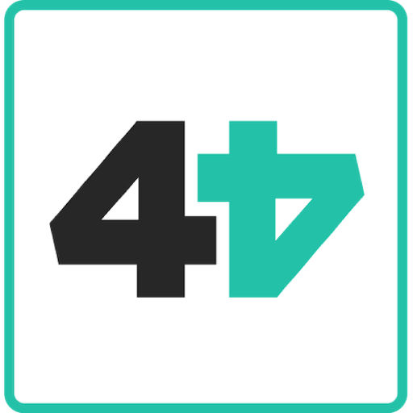

# 4OVER4 plugin



Find, configure and price custom printing from 4OVER4.COM inside Claude, then order on www.4over4.com. 4OVER4 has printed online since 1999, in its own plant in Queens, NY.

## Install

In Claude Code:

```
/plugin install 4over4 --marketplace 40ver4/4over4-connector
```

## What it does

The plugin connects Claude to the 4OVER4 MCP server at `https://www.4over4.com/appsapi/mcp` and adds three skills:

| Skill | What it helps with |
|---|---|
| `find-and-price-print` | Find a product, compare products, get a live price for a quantity, see price breaks and estimated delivery dates |
| `order-on-4over4` | Build a configured cart and hand you a link to www.4over4.com, where you upload artwork, choose shipping and pay |
| `track-my-orders` | After you sign in: your orders, tracking, invoices, account, coins, and the link to cancel an order on www.4over4.com |

Prices, specs and dates come live from the 4OVER4 tools. The plugin takes no payment: you pay only on www.4over4.com.

## What it runs and connects to

- **One remote MCP server:** `https://www.4over4.com/appsapi/mcp` (Streamable HTTP), run by 4OVER4.COM Inc. The plugin connects to no other service.
- **No local code:** no scripts, hooks, commands or packages run on your machine.
- **Sign-in:** the account tools use OAuth 2.1 at `https://www.4over4.com/appsapi/oauth`. Claude opens the 4OVER4 sign-in page when a tool needs it. The plugin never asks for your password or an API key.

## Privacy

- **Without sign-in,** the tools read only public product, price, delivery and help information. Your requests to the tools (for example a product name, a quantity or a ZIP code) reach our server.
- **After you sign in,** the tools can read your own 4OVER4 orders, tracking, invoices, profile, saved addresses, QR codes, coins and cart, when you ask for them. They never cancel an order: `cancel_order` gives the link to your orders page on www.4over4.com, where you cancel it yourself.
- **What we receive:** the tool request Claude sends and, after sign-in, a connection token. We do not receive the rest of your conversation, and Claude never sees your 4OVER4 password.
- **How long sign-in lasts:** up to 30 days; each access grant lasts 1 hour and renews by itself. Disconnect 4OVER4 in Claude's settings at any time.
- **Never collected here:** card numbers or other payment details. Artwork upload, shipping and payment happen only on www.4over4.com.
- The full policy: https://www.4over4.com/company/privacy-policy#ai-assistants

## Support

Email connector@4over4.com. Help page for AI agents: https://www.4over4.com/ai-agents. Terms: https://www.4over4.com/company/terms-and-conditions

## License

MIT, see [LICENSE](LICENSE). The license covers the files in this repository only. The 4OVER4 name and logo stay the property of 4OVER4.COM Inc. and may be used only to refer to 4OVER4.
